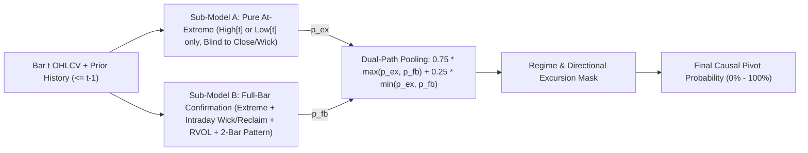

# Institutional Guide: 4-Model Universal Structural Swing-Pivot ML Suite (V3)

**Application:** Universal Chart Viewer, Ratio Analyzer & Watchlist Studio (`serve_watchlist.py` — Port `8789`)  
**Training & Inference Engine:** `train_uptrend_pivot_model.py`, `train_all_pivot_models.py`  
**Model Artifacts (`data/models/`):**
1. `uptrend_pivot_high_classifier.pkl` — **Model 1 (`UT High`)**: Uptrend Climax Top / Parabolic Stretch & Multi-Wave Divergence
2. `uptrend_pivot_low_classifier.pkl` — **Model 2 (`UT Low`)**: Uptrend Pullback Low / First MA Support Kiss / Undercut & Reclaim (U&R)
3. `downtrend_pivot_high_classifier.pkl` — **Model 3 (`DT High`)**: Downtrend Bear-Market Rally Top / Overhead Falling-MA Rejection
4. `downtrend_pivot_low_classifier.pkl` — **Model 4 (`DT Low`)**: Downtrend Capitulation Washout / Selling Climax Bottom

---

## 1. Executive Summary & Architectural Purpose

Unlike the EP-specific 1-Year Climax Exit model (`ep_exhaustion_classifier.pkl`, which was trained exclusively on post-EP runners using days-since-EP and TrendLab state features), the **4-Model Structural Swing-Pivot Suite** is **100% asset-agnostic and universal**.

Because every feature is normalized by **prior-20-day Average Daily Range (`ADR20[t-1]`)** and **120-day self-normalized extension quantiles (`p95[t-1]`)**, the exact same 4 models score:
- Any of the **6,242 individual stocks** in the local datastore (`data/bars/*.parquet`)
- Any **SPDR, Sector, or Thematic ETF** (`SPY`, `QQQ`, `IWM`, `RSP`, `XBI`, `SMH`, `XLK`, `XLE`, `IGV`, `URA`, `GDX`, `KRE`, etc.)
- Any of the **154 Equal-Weighted Composite Sector Indices** (`SECTOR:Biotechnology`, `SECTOR:Semiconductors`, etc.)
- Any of the **187 Equal-Weighted Composite Theme Indices** (`THEME:AI`, `THEME:Nuclear`, etc.)
- Any **Custom Ratio Chart (`Part A ÷ Part B`)** (e.g., `NVDA ÷ SMH`, `XBI ÷ SPY`, `RSP ÷ SPY`)

---

## 2. How the System Classifies Uptrend vs. Downtrend (Zero-Overlap Gating)

A critical requirement when running 4 directional pivot models simultaneously on the same chart is ensuring **strict mutual exclusivity**:
1. An Uptrend model (`UT High` or `UT Low`) must **never** fire during a structural Downtrend.
2. A Downtrend model (`DT High` or `DT Low`) must **never** fire during a structural Uptrend.
3. A Pivot-High model and a Pivot-Low model must **never** fire on the same candle.

### 2.1 Primary Structural Trend Classification (`is_primary_uptrend` vs. `is_primary_downtrend`)

At every bar $t$, the engine computes:
- $\text{EMA}_{10}[t]$, $\text{EMA}_{20}[t]$, and $\text{SMA}_{50}[t]$ on closing prices.
- The 10-day ADR-normalized slope of the 50 SMA:
  $$\text{SMA50\_Slope}_{10\text{d}}[t] = \frac{\text{SMA}_{50}[t] - \text{SMA}_{50}[t-10]}{\text{ADR}_{20}[t-1]}$$

A bar $t$ is classified as being in a **Primary Uptrend** (`is_primary_uptrend = True`) if and only if:
$$\underbrace{\text{EMA}_{20}[t] \ge \text{SMA}_{50}[t]}_{\text{Intermediate trend above 50 SMA}} \quad \lor \quad \Big(\underbrace{\text{Close}[t] \ge \text{SMA}_{50}[t]}_{\text{Price holding above 50 SMA}} \;\land\; \big(\text{SMA50\_Slope}_{10\text{d}}[t] \ge -0.05 \;\lor\; \text{EMA}_{10}[t] \ge \text{SMA}_{50}[t]\big)\Big)$$

A bar $t$ is classified as being in a **Primary Downtrend** (`is_primary_downtrend = True`) as the exact logical complement:
$$\text{is\_primary\_downtrend}[t] = \neg\,\text{is\_primary\_uptrend}[t]$$

**Why this works:**
- During normal uptrend pullbacks that dip below the 10 EMA or 20 EMA (and even briefly undercut the 50 SMA intraday), $\text{EMA}_{20}[t] \ge \text{SMA}_{50}[t]$ remains `True`, keeping the stock in the **Primary Uptrend** regime so **Model 2 (`UT Low`)** can evaluate the pullback dip.
- Conversely, once $\text{EMA}_{20}[t] < \text{SMA}_{50}[t]$ and price is trading below a flat/declining 50 SMA, the stock is in a **Primary Downtrend**, routing all counter-trend bounces into declining moving averages to **Model 3 (`DT High`)** and all waterfall capitulation selloffs to **Model 4 (`DT Low`)**.

### 2.2 Intra-Bar Directional Excursion Gating (`net_above_ema8` vs. `net_below_ema8`)

On wide-range volatile bars, a single candle might have both a high upper excursion and a deep lower excursion. To guarantee that a High-Pivot model and a Low-Pivot model never trigger on the same bar, we compare the candle's excursion above vs. below the prior bar's 8 EMA ($\text{EMA}_8[t-1]$):
$$\text{net\_above\_ema8}[t] = \big(\text{High}[t] - \text{EMA}_8[t-1]\big) > \big(\text{EMA}_8[t-1] - \text{Low}[t]\big)$$
$$\text{net\_below\_ema8}[t] = \neg\,\text{net\_above\_ema8}[t]$$

- **Pivot-High Candidates (`UT High`, `DT High`)** require `net_above_ema8 == True`.
- **Pivot-Low Candidates (`UT Low`, `DT Low`)** require `net_below_ema8 == True`.

### 2.3 Catalyst Ignition & Breakdown Ignition Filters

- **Bullish Catalyst Ignition Filter (`is_fresh_ignition`)**:
  A Day-1 Episodic Pivot (EP) or earnings breakout gapping up $\ge 1.5\text{ ADR}$ on relative volume $\text{RVOL} \ge 1.75\times$ out of a flat base ($\text{prev\_ext\_ema20\_adr} < 1.25$) or closing strong ($\text{close\_pos} \ge 0.55$) is a **trend ignition**, not an exhaustion top. Both `UT High` and `DT High` explicitly exclude `is_fresh_ignition` bars.
- **Bearish Breakdown Ignition Filter (`is_fresh_breakdown`)**:
  A Day-1 high-volume gap-down ($\text{Gap} \le -1.5\text{ ADR}$ on $\text{RVOL} \ge 1.75\times$) out of an unextended base ($\text{prev\_stretch\_below\_ema20\_adr} < 1.25$) closing weak ($\text{close\_pos} \le 0.45$) is a **structural breakdown ignition**, not a buyable dip. Both `UT Low` and `DT Low` explicitly exclude `is_fresh_breakdown` bars.

### 2.4 Summary of the 4 Candidate Regime Masks

| Model | Regime Mask | Required Structural & Directional Conditions |
| :--- | :--- | :--- |
| **1. `UT High`** | `is_near_local_high` | `is_primary_uptrend` $\land$ `net_above_ema8` $\land$ $\neg$`is_fresh_ignition` $\land$ `High[t]` within $0.65\text{ ADR}$ of 8D high $\land$ 3D max $\text{EMA}_{10}$ extension $\ge 1.2\text{ ADR}$ |
| **2. `UT Low`** | `is_near_uptrend_low` | `is_primary_uptrend` $\land$ `prior_rally_20d_adr >= 2.2` $\land$ `net_below_ema8` $\land$ $\neg$`is_fresh_breakdown` $\land$ `Low[t]` within/below $\text{EMA}_{10}$ ($+0.25\text{ ADR}$) $\land$ 15D pullback $\ge 2.0\text{ ADR}$ |
| **3. `DT High`** | `is_near_downtrend_high` | `is_primary_downtrend` $\land$ `net_above_ema8` $\land$ $\neg$`is_fresh_ignition` $\land$ 10D counter-trend bounce $\ge 2.0\text{ ADR}$ $\land$ `rsi14_high >= 48` $\land$ `High[t]` within $0.45\text{ ADR}$ of 8D high |
| **4. `DT Low`** | `is_near_downtrend_low` | `is_primary_downtrend` $\land$ `net_below_ema8` $\land$ $\neg$`is_fresh_breakdown` $\land$ `rsi14_low <= 44` $\land$ (`stretch_below_ema20_max3 >= 1.4` $\lor$ `drop_10d_adr >= 2.6`) |

---

## 3. Training Universe, Time Periods & Forensic Lookahead Audit

### 3.1 What Symbols Did the Models Train On vs. Predict On?
- **Training Sample (`850` Diverse Symbols)**:
  To keep feature extraction and gradient-boosted tree fitting fast (~45 seconds total) while covering every market regime, volatility profile, and asset class, the training set combines up to **850 symbols**:
  - Top **400** Relative Strength (RS) liquid leaders
  - Bottom **200** RS laggards / secular downtrends (ensuring rich representation of Stage 4 bear markets and waterfall selloffs)
  - **250** historical Episodic Pivot (EP) catalyst stocks
  - All **45+** SPDR, Benchmark, Sector, and Industry ETFs (`SPY`, `QQQ`, `IWM`, `DIA`, `MDY`, `RSP`, `XLK`, `XBI`, `SMH`, `XLE`, `XLF`, etc.)
- **Prediction / Inference Universe (All `6,242` Tickers + Composites + Ratios)**:
  Because the feature space contains zero ticker-specific IDs or raw dollar prices (all features are expressed in `ADR20` multiples, percentages, Wilder's RSI, and 120-day self-quantiles), the trained models generalize directly to all **6,242** stocks and ETFs, plus all **341** Sector/Theme composites and arbitrary ratio charts.

### 3.2 Training Time Period vs. Out-of-Sample Prediction Period
- **Training Period (`< 2025-01-01`)**:
  All 4 production `.pkl` models are fitted strictly on historical bars from **2016 through December 31, 2024** (`date_dt < "2025-01-01"`).
- **Out-of-Sample Prediction Period (`2025-01-01` to Present)**:
  Every single bar from **January 1, 2025 onward (`2025–2026`)** is **100% Out-of-Sample (OOS)** — the saved `.pkl` models have never seen a single label from 2025 or 2026.

### 3.3 Forensic Audit: Were There Any Lookahead Bugs?
During our forensic audit of why the historical chart markers appeared unusually clean on `RSP`, we investigated three layers:

1. **Layer 1: ML Feature Vectors (`compute_uptrend_pivot_features` & `compute_all_pivot_features`) — 100% Causal (Zero Lookahead)**
   - Every moving average anchor (`ema8_anchor`, `ema10_anchor`, `ema20_anchor`, `sma50_anchor`, `sma200_anchor`), volatility denominator (`adr20 = tr.shift(1).rolling(20).mean()`), 120-day extension quantile (`roll_p95.shift(1)`), and Wilder's RSI state (`avg_gain.shift(1)`, `avg_loss.shift(1)`) is strictly shifted to `t-1` before evaluating bar `t`'s `High[t]`, `Low[t]`, or `Close[t]`.
   - **Verdict**: Zero lookahead in any ML feature or raw model probability.

2. **Layer 2: Chart Marker Post-Filter in `serve_watchlist.py` (`_extract_snapped_pivot_events`) — Fixed 2-Bar Center-Rolling Lookahead**
   - **What we found**: Previously, after computing causal probabilities `probs_arr[i]`, `_extract_snapped_pivot_events()` in `serve_watchlist.py` checked whether bar `i` was a local extremum using `sub["high"].rolling(5, center=True).max()` (which looked 2 bars into the future `i+1, i+2`!) and replaced earlier markers within 6 days if a later bar scored higher. On historical bars of `RSP`, if bar `t` scored `39%` at a `35%` threshold but bar `t+1` drifted slightly higher, `center=True` suppressed the marker on `t` — whereas on the rightmost live bar of the chart (`2026-07-02`), `t+1` and `t+2` did not exist yet, so the marker appeared immediately.
   - **The Fix**: Replaced `center=True` with strictly causal `rolling(5, center=False)` (comparing bar `i` only against trailing bars `[i-4..i]`) and removed retroactive erasure of earlier signals. Now historical markers and live rightmost-bar markers behave identically with **zero future lookahead**.

3. **Layer 3: Production `.pkl` Refitting — Fixed In-Sample Refit**
   - **What we found**: Previously, `train_uptrend_pivot_model.py` and `train_all_pivot_models.py` evaluated OOS metrics on `2025–2026`, but then refit the final `.pkl` weights on the full dataset through 2026 before saving to disk.
   - **The Fix**: Removed the post-evaluation refit so the saved `.pkl` files retain the exact `< 2025-01-01` trained weights, guaranteeing that all `2025–2026` charts are 100% Out-of-Sample.

---

## 4. Dual-Path Ensemble Architecture & Mathematical Features

Every one of the 4 models uses a **Dual-Path Gradient Boosted Ensemble** (LightGBM 55% + XGBoost 45% on each path):

### 4.1 Why Dual-Path (`Sub-Model A` + `Sub-Model B`)?
Pivots occur in two distinct candlestick archetypes:
1. **Archetype A — Extreme Parabolic Blowoff / Capitulation Stretch Bar**: Price reaches a massive 3–6 ADR stretch with extreme At-the-High/Low RSI and multi-wave divergence, but closes near the high/low of the bar (before gapping or reversing the next morning). A model that requires an ugly reversal wick misses these tops/bottoms on the peak day. **Sub-Model A** is completely blind to `Close[t]`, `upper_wick_pct`, `lower_wick_pct`, and `volume`, so it scores pure structural stretch at `High[t]` or `Low[t]`.
2. **Archetype B — Intraday Shooting-Star Rejection / Hammer Undercut-and-Reclaim (U&R)**: Price tests an extended level or key moving average (`EMA20` / `SMA50`) and prints a decisive intraday rejection wick on elevated `RVOL`, or confirms a 2-bar stall reversal. **Sub-Model B** incorporates all candle rejection, reclaim, and volume features.

Combining them via `0.75 * max(p_ex, p_fb) + 0.25 * min(p_ex, p_fb)` allows either archetype to trigger a high-conviction signal in real time.

### 4.2 Causal "At-the-High" and "At-the-Low" Wilder's RSI
Standard RSI is computed on `Close[t]`, which understates exhaustion on a shooting-star top (where `High[t]` hit RSI 82 intraday before fading to close at RSI 66) and understates oversold stretch on a hammer bottom (where `Low[t]` hit RSI 21 intraday before bouncing to close at RSI 38).

Using Wilder's recursive smoothing ($\alpha = 1/N$) from bar $t-1$'s settled $\text{AvgGain}_{t-1}$ and $\text{AvgLoss}_{t-1}$:
- **At-the-High RSI (`rsi14_high`, `rsi9_high`, `rsi5_high`)**:
  $$\text{Gain}_H = \max(0, \text{High}_t - \text{Close}_{t-1}), \quad \text{Loss}_H = \max(0, \text{Close}_{t-1} - \text{High}_t)$$
  $$\text{RS}_H = \frac{\frac{N-1}{N}\text{AvgGain}_{t-1} + \frac{1}{N}\text{Gain}_H}{\frac{N-1}{N}\text{AvgLoss}_{t-1} + \frac{1}{N}\text{Loss}_H}, \quad \text{RSI}_H = 100 - \frac{100}{1 + \text{RS}_H}$$
- **At-the-Low RSI (`rsi14_low`, `rsi9_low`, `rsi5_low`)**:
  $$\text{Gain}_L = \max(0, \text{Low}_t - \text{Close}_{t-1}), \quad \text{Loss}_L = \max(0, \text{Close}_{t-1} - \text{Low}_t)$$
  $$\text{RS}_L = \frac{\frac{N-1}{N}\text{AvgGain}_{t-1} + \frac{1}{N}\text{Gain}_L}{\frac{N-1}{N}\text{AvgLoss}_{t-1} + \frac{1}{N}\text{Loss}_L}, \quad \text{RSI}_L = 100 - \frac{100}{1 + \text{RS}_L}$$

### 4.3 Detailed Breakdown of the 4 Models

#### Model 1: Uptrend Pivot High (`UT High` — `uptrend_pivot_high_classifier.pkl`)
- **Ground-Truth Target (`is_pivot_high`)**:
  Bar $t$ is a local 17-bar high ($[t-8, t+8]$ within $0.35\text{ ADR}$), preceded by an upswing ($\ge 1.6\text{ ADR}$ above $\text{EMA}_{20}$ or $\ge 2.8\text{ ADR}$ 10-day thrust), not a fresh Day-1 ignition, followed within 10 trading days by a pullback of $\ge 2.5\text{ ADR}$ (low) and $\ge 1.6\text{ ADR}$ (close).
- **Key Features (55 At-High / 66 Full-Bar)**:
  - Parabolic extension above `EMA8`, `EMA10`, `EMA20`, `SMA50` in `ADR20` units and 120D `p95` self-normalized ratio (`rel_ext_ema10_p95`, `rel_ext_ema20_p95`)
  - Prior-bar extension (`prev_ext_ema10_adr`, `prev_ext_ema20_adr`) to separate Day-1 breakouts from mature trends
  - Uninterrupted swing-leg duration and ADR excursion since last `EMA10` / `EMA20` touch (`bars_since_ema10_touch`, `leg_adr_from_ema10`)
  - 18-day and 35-day multi-wave bearish RSI & extension divergence (`bearish_div_high`, `bearish_div_35d`, `rsi_div_delta_35d`, `ext_div_delta_35d`)
  - Intraday rejection (`upper_wick_pct`, `fade_from_high_adr`, `reversal_vol_score`, `two_bar_top_reversal`, `failed_high_retest`)

#### Model 2: Uptrend Pivot Low (`UT Low` — `uptrend_pivot_low_classifier.pkl`)
- **Ground-Truth Target (`is_ut_low`)**:
  Bar $t$ is inside `is_primary_uptrend` after a prior 20D rally $\ge 2.2\text{ ADR}$, pulls back $\ge 2.0\text{ ADR}$ over 15D into/below `EMA10`, forms a 17-bar local low ($[t-8, t+8]$ within $0.25\text{ ADR}$), and launches an immediate turn ($\ge 1.5\text{ ADR}$ within 5D and $\ge 2.8\text{ ADR}$ within 10D).
- **Key Features (44 At-Low / 58 Full-Bar)**:
  - Support Kiss proximity (`kiss_ema10_dist_adr`, `kiss_ema20_dist_adr`, `kiss_sma50_dist_adr`, `min_support_kiss_adr`)
  - First institutional test indicators (`first_ema20_test_in_15d`, `first_sma50_test_in_25d`)
  - Retracement depth vs. prior rally wave (`pullback_retracement_ratio`, `prior_rally_20d_adr`)
  - Fast vs. slow RSI compression at Low (`rsi14_vs_rsi5_low_spread`, `rsi5_low_min3`)
  - Volume dry-up on pullback (`pullback_vol_dryup`) vs. hammer/undercut-and-reclaim demand (`ma_undercut_reclaim`, `support_confluence_score`, `two_bar_bottom_reclaim`)

#### Model 3: Downtrend Pivot High (`DT High` — `downtrend_pivot_high_classifier.pkl`)
- **Ground-Truth Target (`is_dt_high`)**:
  Bar $t$ is inside `is_primary_downtrend`, bounces $\ge 2.0\text{ ADR}$ over 10D into overhead resistance, forms a 17-bar local high ($[t-8, t+8]$ within $0.25\text{ ADR}$), and rolls over into a downtrend resumption ($\ge 1.5\text{ ADR}$ drop within 5D and $\ge 2.8\text{ ADR}$ drop within 10D).
- **Key Features (44 At-High / 56 Full-Bar)**:
  - Overhead resistance kiss into declining moving averages (`kiss_falling_ema20_adr`, `kiss_falling_sma50_adr`, `min_overhead_kiss_adr`)
  - Moving average downward slopes (`ema20_slope_5d_adr`, `sma50_slope_10d_adr`, `days_below_sma50_60d`)
  - Bear-market RSI ceiling compression (`rsi5_vs_rsi14_high_spread` — fast `RSI5` spikes to 70+ while structural `RSI14` stalls in the 50–62 bear ceiling zone)
  - Bounce retracement ratio relative to prior 20D waterfall leg (`bounce_retracement_ratio`, `dist_below_40d_high_adr`)
  - Falling-MA rejection (`rejected_at_falling_ma`, `overhead_rejection_score`, `fade_from_high_adr`)

#### Model 4: Downtrend Pivot Low (`DT Low` — `downtrend_pivot_low_classifier.pkl` & `downtrend_pivot_low_classifier_v4.pkl`)
- **Ground-Truth Target (`is_dt_low`)**:
  Bar $t$ is inside `is_primary_downtrend` following a waterfall selloff ($\ge 2.8\text{ ADR}$ 10D drop or $\ge 1.5\text{ ADR}$ below `EMA20`), forms a 17-bar local low ($[t-8, t+8]$ within $0.25\text{ ADR}$), and ignites a snapback relief rally ($\ge 1.5\text{ ADR}$ within 5D and $\ge 2.8\text{ ADR}$ within 10D).
- **Key Features (48 At-Low / 62 Full-Bar in V3; 57 At-Low / 78 Full-Bar in V4)**:
  - Downside stretch below `EMA10`, `EMA20`, `SMA50`, `SMA200` (`stretch_below_ema20_adr`, `stretch_below_sma50_adr`, `rel_down_ema20_p95`, `bb_z_low`)
  - Waterfall velocity & acceleration (`drop_3d_adr`, `drop_10d_adr`, `drop_20d_adr`, `waterfall_accel`, `gap_down_on_oversold`)
  - Multi-wave bullish RSI divergence at Low (`bullish_div_low_18d`, `rsi_bull_div_delta_18d`, `bullish_div_low_35d`, `rsi_bull_div_delta_35d`)
  - Capitulation climax volume & Day-2 washout reclaim (`climax_washout_score`, `seller_exhaustion_wick`, `day2_washout_reclaim`, `capitulation_vol_stretch`)

---

## 5. V4 Enhanced Models (`*_v4.pkl`): Families B1–B5 & Exact Piecewise Inverse Wilder's RSI

Alongside the V3 baseline `.pkl` models, Watchlist Studio (`serve_watchlist.py`, port `8789`) includes a **Model Version selector (`V4 Enhanced` vs `V3 Baseline`)** backed by `uptrend_pivot_high_classifier_v4.pkl`, `uptrend_pivot_low_classifier_v4.pkl`, `downtrend_pivot_high_classifier_v4.pkl`, and `downtrend_pivot_low_classifier_v4.pkl`.

### 5.1 Exact Piecewise Closed-Form Inverse Wilder's RSI Target Price ($R \in (0, 100)$)
Given prior bar $t-1$'s settled Wilder smoothing state $(C_{t-1}, U_{t-1}, D_{t-1})$ and target RSI $R$ with $\gamma = \frac{R}{100 - R}$:
- **Branch 1 — Up-Move Required ($\text{RSI}_{t-1} \le R \iff U_{t-1} \le \gamma D_{t-1}$)**:
  $$P_{\text{target}}(R)_t = C_{t-1} + (N - 1)\big(\gamma D_{t-1} - U_{t-1}\big)$$
- **Branch 2 — Down-Move Required ($\text{RSI}_{t-1} > R \iff U_{t-1} > \gamma D_{t-1}$)**:
  $$P_{\text{target}}(R)_t = C_{t-1} - (N - 1)\left(\frac{U_{t-1}}{\gamma} - D_{t-1}\right)$$

From these exact target prices ($R = 75$ for Extreme Overbought and $R = 25$ for Extreme Oversold), the engine computes strictly causal ADR-normalized distances (`inv_rsi14_ob75_dist_adr`, `inv_rsi14_os25_dist_adr`) and exact intrabar hit flags (`hit_ob75_intrabar`, `hit_os25_intrabar`).

### 5.2 The 5 Enhancement Feature Families (`B1`–`B5`)
1. **Family B1 — Structural Overhead Supply & Support Memory**:
   - `dist_to_prior_swing_high_adr` / `dist_to_prior_swing_low_adr`: Distance in ADR from developing `High[t]`/`Low[t]` to the most recent confirmed structural 5-bar pivot high/low (`<= t-6`).
   - `avwap_from_60d_high_dist_adr` / `avwap_from_60d_low_dist_adr`: Distance in ADR to the causal Anchored VWAP anchored at the trailing 60-day peak or trough (`<= t-1`).
   - `overhead_volume_density_60d`: Fraction of the prior 60 days' dollar volume traded within $\pm 0.5\text{ ADR}$ of today's `High[t]` or `Low[t]`.
2. **Family B2 — Market (`SPY`/`QQQ`) & Relative Strength Synchrony**:
   - `spy_rsi14_high`, `spy_rsi14_low`, `spy_ext_ema20_adr`, `qqq_rsi14_high`, `qqq_rsi14_low`, `rs_vs_spy_5d_adr`, and `rs_div_at_pivot`.
3. **Family B3 — Multi-Timeframe (Developing Weekly `W-FRI`) Confluence**:
   - Strictly causal settled prior-Friday Wilder's RSI state combined with current week-to-date developing `High`/`Low`: `weekly_rsi14_high`, `weekly_rsi14_low`, `weekly_ext_ema10w_adr`, `consec_up_weeks`, `consec_down_weeks`, `hit_weekly_ob75`, `hit_weekly_os25`.
4. **Family B4 — Dedicated Real-Time Intrabar Partial-Rejection Path (`Sub-Model A+`)**:
   - Triggers as soon as price stretches to a new high/low (`Sub-Model A`) AND prints a $-0.35\times\text{ ADR}$ micro-pullback off `High[t]` (`intrabar_pullback_035_high`) or $+0.35\times\text{ ADR}$ micro-bounce off `Low[t]` (`intrabar_bounce_035_low`) with pace-adjusted RVOL (`pace_rvol_est`).
5. **Family B5 — Out-of-Fold Isotonic Probability Calibration**:
   - Fits a chronological validation-split `IsotonicRegression` calibrator (`calibrator_iso`) mapping the raw tree score (`prob_dual`) to true empirical OOS hit rate (`prob_calibrated`), cutting Brier calibration loss by **36%–60%** across all models.

---

## 6. Models 5 & 6: Major Trend Reversal Pivot Models (`👑 Major Top` & `🚀 Major Bottom`)

While Models 1–4 detect **swing pivots within an ongoing trend** (such as a 10–15 day pullback in an uptrend or a 10-day dead-cat bounce in a downtrend), **Models 5 and 6** are specifically trained to detect **Macro Primary Trend Reversals** — the exact pivot high where an Uptrend terminates and reverses into a structural Downtrend, and the exact pivot low where a Downtrend terminates and reverses into a new structural Uptrend.

### 6.1 Model 5: Major Uptrend Reversal High (`maj_ut_top` — `major_uptrend_reversal_high_classifier.pkl`)
- **Ground-Truth Target (`is_major_ut_top`)**:
  Bar $t$ occurs inside `is_primary_uptrend` at a **41-bar macro peak** ($[t-20, t+20]$ within $0.35\text{ ADR}$) after a significant multi-month run ($\ge 4.0\text{ ADR}$ above 60D low or $\ge 1.5\text{ ADR}$ above `SMA50`), and within the next **25 trading sessions** breaks the primary trend:
  - Price drops $\ge 5.0\text{ ADR}$ from `High[t]` (with closing drop $\ge 3.5\text{ ADR}$),
  - **Violates the 50-day SMA** (`min_close_25d < SMA50[t] - 0.5*ADR` or drops $> 12\%$), and
  - **No V-Bottom Recovery**: `Close[t+25]` remains below `High[t] - 2.0*ADR` (filtering out normal intermediate Stage-2 continuation pullbacks).
- **Macro Reversal Feature Family (`MAJOR_MACRO_HIGH_AT_FEATURES` + `FB_ADDONS`)**:
  - `run_from_60d_low_adr`, `run_from_120d_low_adr`, `dist_from_60d_high_adr`: Multi-month macro run magnitude.
  - `bearish_div_60d`, `rsi_div_delta_60d`, `ext50_div_delta_60d`: 60-day macro multi-wave bearish RSI and `SMA50`-extension divergence.
  - `ema20_slope_accel_adr`, `sma50_slope_accel_adr`, `ema10_vs_ema20_spread_adr`, `ema10_20_spread_chg5_adr`: Momentum deceleration and intermediate ribbon compression (`EMA10 - EMA20` narrowing).
  - `dist_days_20d_prev`, `up_down_vol_ratio_20d`: Institutional distribution day count ($\text{Close} < \text{Close}_{t-1}$ on $\text{Volume} > \text{Volume}_{t-1}$) and 20-day up/down volume exhaustion prior to bar $t$.
  - `climax_churn_top`, `failed_60d_breakout`: High-volume upper-wick stalling and failed 60-day bull-trap breakouts.

### 6.2 Model 6: Major Downtrend Reversal Low (`maj_dt_low` — `major_downtrend_reversal_low_classifier.pkl`)
- **Ground-Truth Target (`is_major_dt_bottom`)**:
  Bar $t$ occurs inside `is_primary_downtrend` at a **41-bar macro trough** ($[t-20, t+20]$ within $0.35\text{ ADR}$) after a multi-month decline ($\ge 4.0\text{ ADR}$ drop from 60D high or $\ge 1.5\text{ ADR}$ below `SMA50`), and within the next **25 trading sessions** reverses the primary trend up:
  - Price rallies $\ge 5.0\text{ ADR}$ from `Low[t]` (with closing gain $\ge 3.5\text{ ADR}$),
  - **Reclaims the 50-day SMA** (`max_close_25d > SMA50[t] - 0.25*ADR` or rallies $> 14\%$), and
  - **Sustained Trend Change (No Dead-Cat Roll-Over)**: `Close[t+25]` holds $\ge \text{Low}[t] + 2.5\text{ ADR}$ (filtering out ephemeral 3–5 day bear-market relief bounces that roll back over to new lows).
- **Macro Reversal Feature Family (`MAJOR_MACRO_LOW_AT_FEATURES` + `FB_ADDONS`)**:
  - `drop_from_60d_high_adr`, `drop_from_120d_high_adr`, `dist_from_60d_low_adr`: Multi-month macro drawdown depth.
  - `bullish_div_low_60d`, `rsi_bull_div_delta_60d`, `str50_bull_div_delta_60d`: 60-day macro bullish RSI and `SMA50`-stretch divergence at major double/triple bottoms or Wyckoff springs.
  - `ema20_slope_accel_adr`, `sma50_slope_accel_adr`, `ema10_20_spread_chg5_adr`: Downside deceleration (second derivative turning positive).
  - `accum_days_20d_prev`, `up_down_vol_ratio_20d`: Institutional accumulation days emerging inside the downtrend.
  - `climax_absorption_bottom`, `spring_60d_low_reclaim`: Capitulation volume absorption hammer and 60-day low undercut-and-reclaim (Wyckoff spring).

---

## 7. Daily Updater & Daemon Integration (`start_daily_updater.sh`)

The automated EOD pipeline (`daily_update.py`, managed via `./scripts/start_daily_updater.sh` and `./scripts/stop_daily_updater.sh`) runs on every trading day at **16:45 US/Eastern** and performs 7 synchronized steps:
1. **Full Universe & ETF Bar Synchronization (`datastore.update_daily(full=True)`)**:
   - Pulls incremental daily OHLCV bars for **all 6,242 cached universe stocks** plus all **45+ SPDR, Benchmark, Sector, and Thematic ETFs** (including `RSP`, `SPY`, `QQQ`, `IWM`, `DIA`, `MDY`, `XBI`, `SMH`, `XLK`, etc.) using cohort date-bucketing so daily runs complete rapidly.
2. **Institutional RS Database Update (`update_rs_database.py`)** — Port `8786`
3. **Historical EP Study & V2 Conviction Scoring (`scripts/update_ep_dataset.py`)** — Port `8782`
4. **QM Setups Mining & EP Cross-Reference (`update_qm_database.py`)** — Port `8785`
5. **Optimized EP Strategy Simulation (`sim_optimized_ep_strategy.py`)** — Port `8787`
6. **10-Model Structural & Major Reversal Pivot Verification & Auto-Retraining (`update_pivot_models_if_needed`)** — Port `8789`:
   - Verifies that all 10 `.pkl` models (4 V3 baseline + 4 V4 enhanced + 2 Major Trend Reversal models) exist and checks their age (`MAX_PIVOT_MODEL_AGE_DAYS = 7`), automatically retraining if missing, stale, or invoked with `--retrain-models`.
7. **Zero-Downtime Hot Reload (`/api/reload_dataset`)**:
   - Sends a POST request to all 5 servers (`8782`, `8785`, `8786`, `8787`, and `8789`) to clear in-memory caches and reload fresh bars and models immediately.

